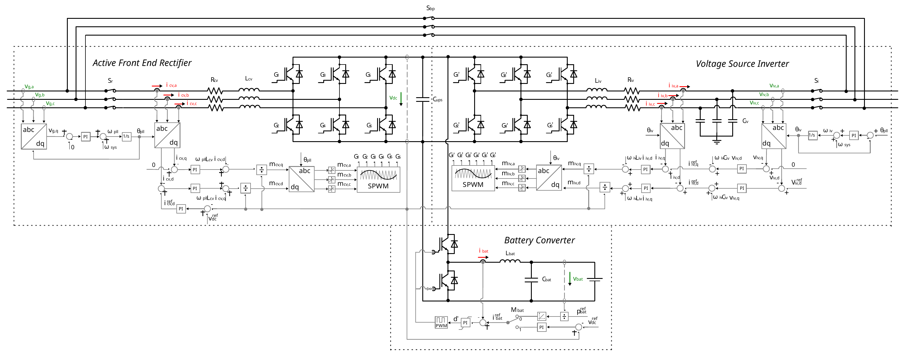
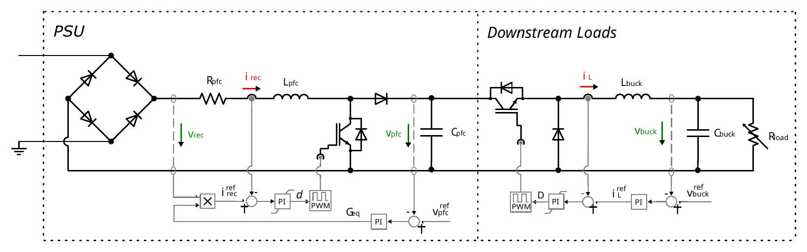
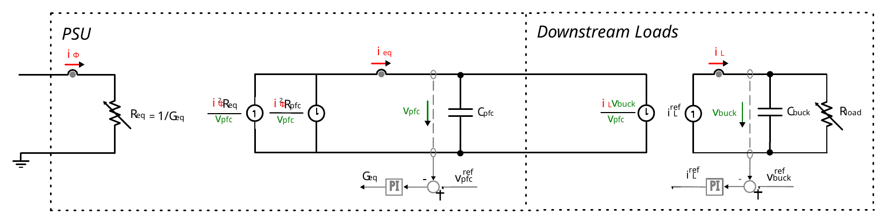
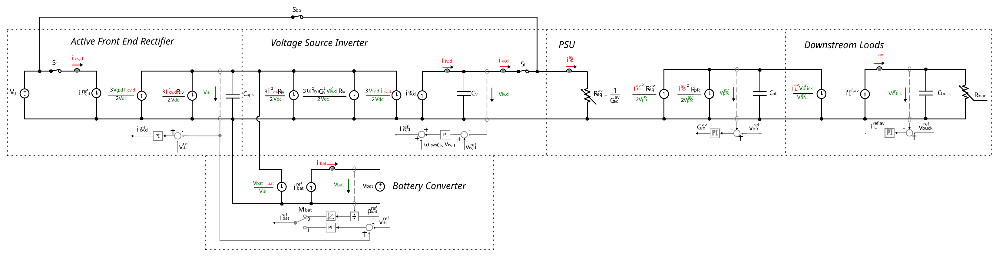
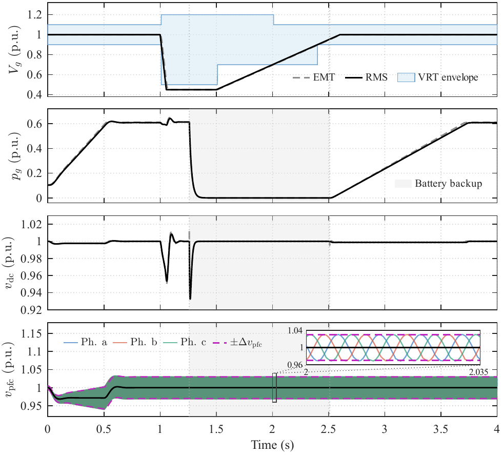
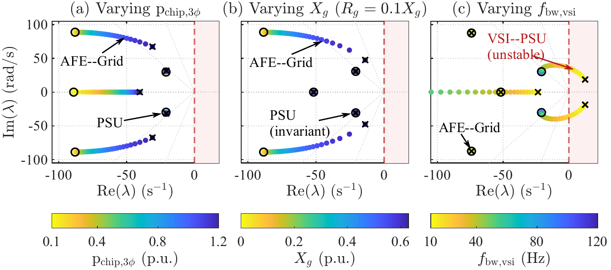
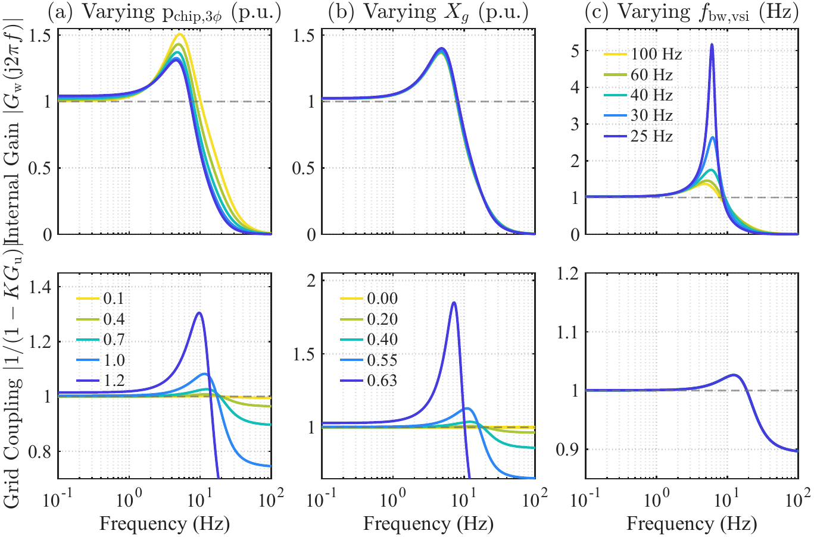

# DC-RMS: Dynamic RMS & EMT Models of Data Center Computing Loads

Open-source **MATLAB RMS** and **PSCAD/EMTDC EMT** models of UPS-fed AI data center computing loads for power system stability and oscillation studies, developed at the **Thayer School of Engineering, Dartmouth College**.

This repository accompanies the paper:

> **Dynamic Modeling of Data Center Computing Loads for Power System Studies: From EMT to RMS**
>
> Xingyu Zhao, Junbo Zhao, and Yingyi Tang — Thayer School of Engineering, Dartmouth College

## Overview

Modern AI data centers exhibit abrupt, large-amplitude GPU workload swings and strict voltage ride-through (VRT) behaviors that interact closely with the bulk power grid. This repository provides:

1. **Detailed PSCAD/EMTDC EMT Benchmark (`EMT/`)**: Modular centralized-UPS data center model featuring an Active Front End (AFE), Bidirectional DC–DC Battery Energy Storage System (BESS), Voltage Source Inverter (VSI), programmable sample-and-hold VRT / mode-switching logic, per-phase single-phase PFC Power Supply Units (PSUs), downstream 48 V Buck converters, and time-varying computing loads.

2. **Reduced-Order Per-Unit RMS DAE Model (`RMS/`)**: A 9-state unified per-unit RMS differential-algebraic equation (DAE) model derived systematically from the EMT representation via:

   * **Period averaging** of the single-phase PSUs and downstream Buck loads, plus an analytical consistency estimate for the $2\omega$ PSU DC-link voltage ripple ($\pm\Delta\mathrm{v}_{\mathrm{pfc}}$);

   * **DC-equivalent reduction** of the multi-stage UPS using control-loop time-scale separation and balanced three-phase symmetry.

3. **Small-Signal Modal & Frequency-Domain Analysis (`RMS/`)**: Linearized state-space coupling with a Thévenin equivalent grid ($\mathrm{V}_s$, $\mathrm{R}_g + \mathrm{j}\mathrm{X}_g$), eigenvalue root-locus sensitivity, participation factors, and decomposition of power-swing amplification into **internal gain** and **grid coupling gain** across both **Normal** and **Bypass** modes.

## Model Architecture: From EMT to RMS

### System Topology

The centralized-UPS data center computing load comprises a three-phase double-conversion UPS (AFE, VSI, BESS, and static bypass) feeding balanced three-phase banks of single-phase PFC PSUs and downstream 48 V DC Buck converters:

<p align="center">

</p>

### Detailed EMT Representation

In the EMT model (`EMT/`), the UPS stages retain full three-phase switching/average converter interfaces, $dq$-frame current and voltage control loops, PLL synchronization, and BESS bidirectional DC–DC dynamics, while each per-phase PSU and downstream Buck stage retains its rectifier/boost PFC and DC–DC converter control loops:

<p align="center">

</p>
<p align="center">

</p>

### Reduced-Order RMS Representation

Applying **period averaging** over a fundamental cycle reduces the per-phase PSU and downstream Buck converter to a time-invariant, balanced DC-equivalent representation:

<p align="center">

</p>

Combining the period-averaged PSU/Buck stages with **DC-equivalent reduction** of the UPS (eliminating fast inner current loops and redundant phase/$q$-axis dynamics) yields the complete 9-state per-unit RMS DAE model (`RMS/`):

<p align="center">

</p>

## Repository Structure

```
DC-RMS/
├── README.md
├── docs/
│   └── figures/                           # PNG diagrams & results rendered in this README
│       ├── topology_datacenter.png        # Overall data center power supply topology
│       ├── ups_emt.png                    # Detailed UPS EMT circuit & control
│       ├── psu_emt.png                    # Detailed PSU & Buck EMT circuit & control
│       ├── psu_rms.png                    # Period-averaged PSU & Buck model
│       ├── rms_model.png                  # Unified DC-equivalent RMS model
│       ├── Fig1_VRT_1_to_5s.png
│       ├── Fig2_LoadProp_5_to_10s.png
│       ├── Fig3_Bypass_2_to_5s.png
│       ├── Fig4_Modal_RootLocus.png
│       ├── Fig5_Gain_FreqResp.png
│       ├── Fig6_Bypass_RootLocus.png
│       ├── Fig7_Bypass_Gain_FreqResp.png
│       └── Fig8_Normal_Oscillation_6Hz.png
├── EMT/                                   # PSCAD/EMTDC benchmark models
│   ├── DC_EMT_lib.pslx                    # Custom component library
│   ├── DC_EMT_ws.pswx                     # PSCAD workspace
│   ├── DC_EMT_normal.pscx                 # Normal-mode VRT & square-wave load case
│   ├── DC_EMT_bypass.pscx                 # Normal <-> Bypass mode transition case
│   └── DC_EMT_normal_oscillation.pscx     # 6 Hz small-signal amplification case (f_bw,vsi = 25 Hz)
└── RMS/                                   # MATLAB RMS simulation, modal analysis & data
    ├── DC_RMS_Normal.m                    # Reproduces Fig. 1 & Fig. 2
    ├── DC_RMS_Bypass.m                    # Reproduces Fig. 3
    ├── DC_RMS_Modal_Normal.m              # Reproduces Fig. 4 & Fig. 5 (Normal mode)
    ├── DC_RMS_Modal_Bypass.m              # Reproduces Fig. 6 & Fig. 7 (Bypass mode)
    ├── DC_RMS_Oscillation_Normal.m        # Reproduces Fig. 8 (6 Hz resonance validation)
    ├── Normal_EMT_PerUnit_Data.xlsx       # Per-unit EMT dataset for DC_RMS_Normal.m
    ├── Bypass_EMT_PerUnit_Data.xlsx       # Per-unit EMT dataset for DC_RMS_Bypass.m
    ├── Normal_Oscillation_EMT_PerUnit_Data.xlsx
    └── Fig1_*.pdf ... Fig8_*.pdf          # Exported IEEE vector PDF figures


```

## Unified Per-Unit System

All RMS scripts and per-unit EMT Excel datasets are aligned on a common three-phase base:

| Parameter | Symbol | Value | 
| ----- | ----- | ----- | 
| Parallel UPS aggregation | $M_{\mathrm{ups}}$ | $30$ ($1.50~\mathrm{MVA}$ each) | 
| Parallel PSU aggregation per UPS | $M_{\mathrm{psu}}$ | $10$ ($0.05~\mathrm{MVA}$ per phase) | 
| Common 3-phase power base | $\mathrm{S}_b$ | $45.0~\mathrm{MVA}$ | 
| Nominal frequency / AC LL-RMS voltage base | $f_b,\;\mathrm{V}_{\mathrm{LL},b}$ | $60~\mathrm{Hz},\;0.48~\mathrm{kV}$ | 
| UPS / BESS / PSU / Buck DC voltage bases | $\mathrm{V}_{\mathrm{dc},b},\;\mathrm{V}_{\mathrm{bat},b},\;\mathrm{V}_{\mathrm{pfc},b},\;\mathrm{V}_{\mathrm{buck},b}$ | $0.80,\;0.40,\;0.80,\;0.048~\mathrm{kV}$ | 
| Default Thévenin grid (modal & oscillation studies) | $\mathrm{V}_s,\;\mathrm{R}_g,\;\mathrm{X}_g$ | $1.0,\;0.035,\;0.35~\mathrm{p.u.}$ | 

## Quick Start

### Requirements

* **MATLAB** (R2020b or newer; Optimization Toolbox required for `fsolve` in modal/grid-coupled scripts).

* **PSCAD/EMTDC** (optional, only needed to re-run the `.pscx` EMT cases; pre-exported per-unit EMT Excel tables are already included in `RMS/`).

### Running the MATLAB Benchmarks

Open MATLAB, navigate to the `RMS/` directory, and run any script directly:

```
cd RMS

DC_RMS_Normal               % Time-domain VRT & square-wave load benchmark (Fig. 1 & Fig. 2)
DC_RMS_Bypass               % Normal <-> Bypass mode-switching benchmark (Fig. 3)
DC_RMS_Modal_Normal         % Normal-mode root-locus & gain frequency response (Fig. 4 & Fig. 5)
DC_RMS_Modal_Bypass         % Bypass-mode root-locus & gain frequency response (Fig. 6 & Fig. 7)
DC_RMS_Oscillation_Normal   % 6 Hz resonant power-swing amplification check (Fig. 8)


```

Each script prints summary diagnostics (PFC $2\omega$ ripple consistency checks, modal eigenvalues, and participation factors) to the Command Window and exports publication-ready vector PDFs.

## RMS vs. EMT Time-Domain Validation

### 1. Grid Voltage Sag & VRT Battery Backup Transition (`DC_RMS_Normal.m`)

During a grid voltage sag to $0.45~\mathrm{p.u.}$, the UPS transitions to battery backup mode after the VRT ride-through limit and reconnects with a battery soft-recovery ramp once voltage recovers. The RMS model closely tracks the EMT trajectories across $\mathrm{V}_g$, $\mathrm{p}_g$, $\mathrm{v}_{\mathrm{dc}}$, and $\mathrm{v}_{\mathrm{pfc}}$, while the analytical envelope $\mathrm{v}_{\mathrm{pfc}}^{\mathrm{av}} \pm \Delta\mathrm{v}_{\mathrm{pfc}}$ tightly bounds the three-phase $2\omega$ ($120~\mathrm{Hz}$) EMT ripple.

<p align="center">

</p>

### 2. Rapid Computing Load Fluctuation Propagation (`DC_RMS_Normal.m`)

To emulate rapid GPU workload swings in AI training/inference, a periodic square-wave demand ($0.18\text{--}0.78~\mathrm{p.u.}$, $0.5~\mathrm{Hz}$, $70\%$ duty cycle) is applied to $\mathrm{p}_{\mathrm{chip},3\phi}$. The RMS model accurately captures downstream-to-upstream disturbance propagation through the PSU and UPS stages to the grid.

<p align="center">

</p>

### 3. Normal ↔ Bypass Mode Switching (`DC_RMS_Bypass.m`)

Initialized at $\mathrm{p}_{\mathrm{chip},3\phi}=0.7~\mathrm{p.u.}$, switching from normal to bypass mode ($t=0.5~\mathrm{s}$) induces transients in $\mathrm{v}_{\mathrm{dc}}$ and $\mathrm{p}_g$ while leaving $\mathrm{v}_{\mathrm{pfc}}$ undisturbed. Returning to normal mode ($t=1.5~\mathrm{s}$) causes transients across $\mathrm{v}_{\mathrm{dc}}$, $\mathrm{p}_g$, and $\mathrm{v}_{\mathrm{pfc}}$ as the VSI ramps its output current from zero. Both transitions match the EMT benchmark closely.

<p align="center">

</p>

## Small-Signal Modal & Power-Swing Amplification Analysis

### Normal Mode (`DC_RMS_Modal_Normal.m`)

In normal mode (8 active states), the double-conversion UPS decouples the downstream PSUs from grid reactance $\mathrm{X}_g$. Increasing $\mathrm{p}_{\mathrm{chip},3\phi}$ or $\mathrm{X}_g$ shifts the AFE–Grid mode rightward and raises grid coupling gain abruptly near the static voltage-stability limit. Conversely, lowering the VSI voltage-loop bandwidth $f_{\mathrm{bw,vsi}}$ destabilizes the internal VSI–PSU feedback loop (crossing the imaginary axis near $21.5~\mathrm{Hz}$) and strongly amplifies the internal gain around $6~\mathrm{Hz}$.

<p align="center">

</p>
<p align="center">

</p>

### Bypass Mode (`DC_RMS_Modal_Bypass.m`)

In bypass mode (6 active states, VSI disconnected), the PSUs connect directly to the grid POI. Without UPS isolation, heavy loading or weak grid conditions drive the PSU–Grid mode sharply toward the imaginary axis and produce substantially larger, lower-frequency grid-coupling resonance peaks ($3.11\times$ near $1.5~\mathrm{Hz}$ at $\mathrm{X}_g=0.63~\mathrm{p.u.}$).

<p align="center">

</p>
<p align="center">

</p>

### EMT Validation of 6 Hz Resonant Amplification (`DC_RMS_Oscillation_Normal.m`)

Applying a small $6~\mathrm{Hz}$, $\pm 0.02~\mathrm{p.u.}$ sinusoidal perturbation to $\mathrm{p}_{\mathrm{chip},3\phi}$ at $f_{\mathrm{bw,vsi}}=25~\mathrm{Hz}$ confirms strong resonant amplification at the grid terminal ($4.64\times$ **in EMT** vs. $5.23\times$ **in RMS**, with closely aligned phase), directly validating the frequency-domain prediction.

<p align="center">

</p>

## Citation

If you use these models or datasets in your research, please cite:

```
@article{Zhao2026DCRMS,
  author  = {Xingyu Zhao and Junbo Zhao and Yingyi Tang},
  title   = {Dynamic Modeling of Data Center Computing Loads for Power System Studies: From {EMT} to {RMS}},
  year    = {2026},
  note    = {Preprint / Under Review}
}


```
