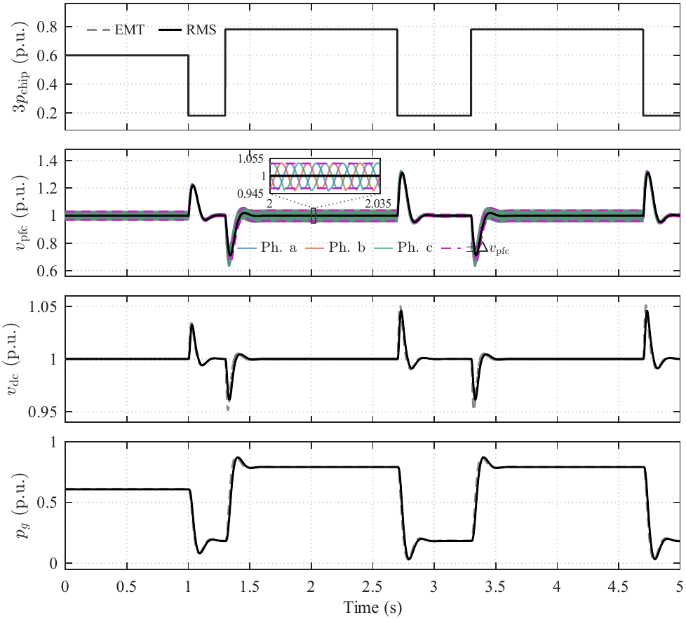
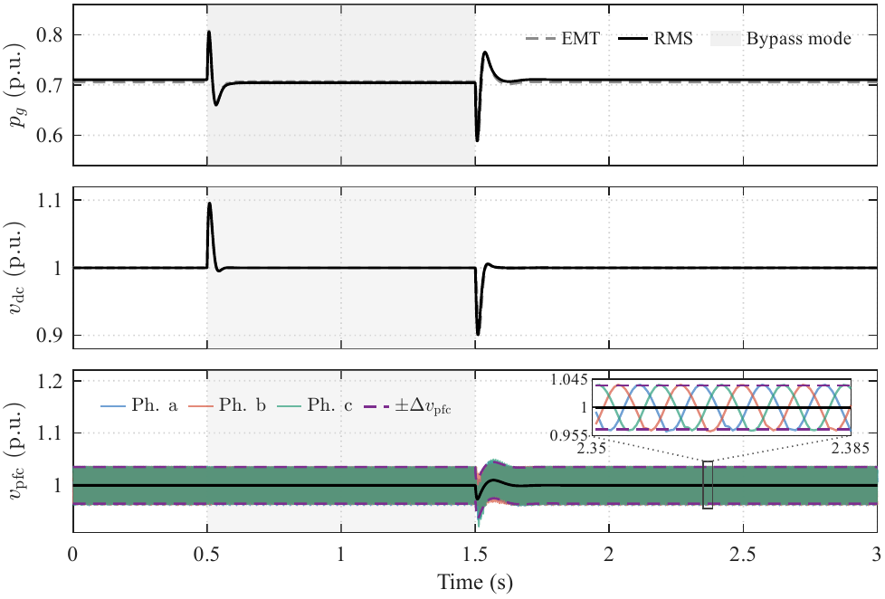
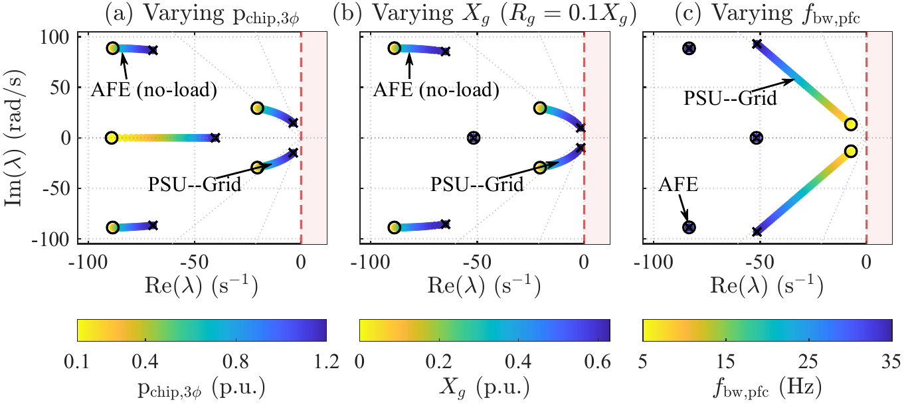
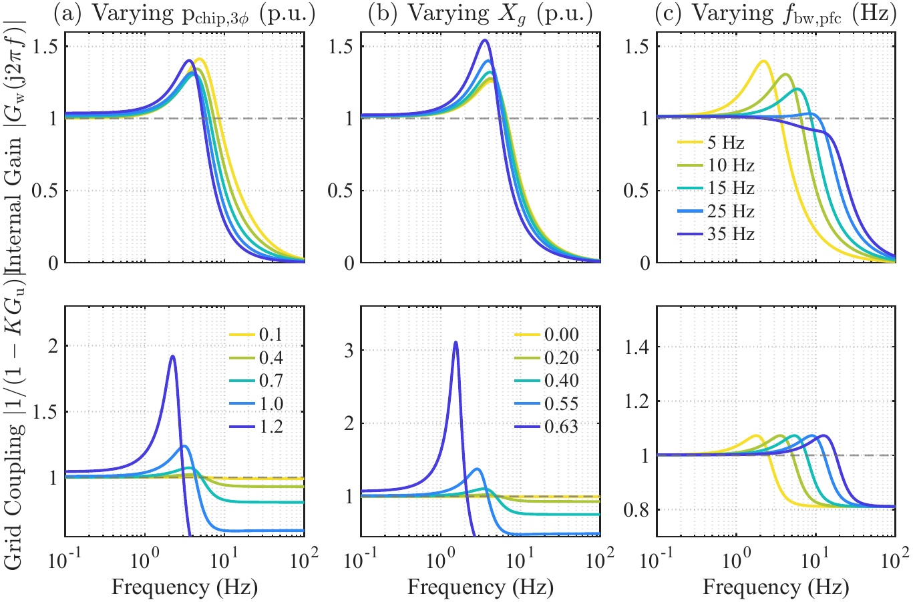

# DC-RMS: Data Center Computing Load RMS & EMT Models

Open-source **MATLAB RMS** and **PSCAD/EMTDC EMT** models of UPS-fed AI data center computing loads for power system stability and oscillation studies, developed at the **Thayer School of Engineering, Dartmouth College**.

Accompanying paper:
> **Dynamic Modeling of Data Center Computing Loads for Power System Studies: From EMT to RMS**  
> Xingyu Zhao, Junbo Zhao, and Yingyi Tang — Thayer School of Engineering, Dartmouth College

## Repository Structure

```text
DC-RMS/
├── README.md
├── docs/figures/                           # PNG result figures rendered below
├── EMT/                                    # PSCAD/EMTDC benchmark models
│   ├── DC_EMT_lib.pslx
│   ├── DC_EMT_ws.pswx
│   ├── DC_EMT_normal.pscx                  # Normal-mode VRT & square-wave load
│   ├── DC_EMT_bypass.pscx                  # Normal <-> Bypass mode switching
│   └── DC_EMT_normal_oscillation.pscx      # 6 Hz small-signal amplification
└── RMS/                                    # MATLAB RMS scripts, data & vector PDFs
    ├── DC_RMS_Normal.m                     # Fig. 1 & Fig. 2
    ├── DC_RMS_Bypass.m                     # Fig. 3
    ├── DC_RMS_Modal_Normal.m               # Fig. 4 & Fig. 5
    ├── DC_RMS_Modal_Bypass.m               # Fig. 6 & Fig. 7
    ├── DC_RMS_Oscillation_Normal.m         # Fig. 8
    ├── Normal_EMT_PerUnit_Data.xlsx
    ├── Bypass_EMT_PerUnit_Data.xlsx
    ├── Normal_Oscillation_EMT_PerUnit_Data.xlsx
    └── Fig1_*.pdf ... Fig8_*.pdf
```

## RMS vs. EMT Time-Domain Validation

### 1. Grid Voltage Sag & VRT Battery Backup Transition (`DC_RMS_Normal.m`)

During a grid voltage sag to $0.45~\mathrm{p.u.}$, the UPS transitions to battery backup mode after the VRT ride-through limit and reconnects with a battery soft-recovery ramp once voltage recovers. The RMS model closely tracks the EMT trajectories across $\mathrm{V}_g$, $\mathrm{p}_g$, $\mathrm{v}_{\mathrm{dc}}$, and $\mathrm{v}_{\mathrm{pfc}}$, while the analytical envelope $\mathrm{v}_{\mathrm{pfc}}^{\mathrm{av}} \pm \Delta\mathrm{v}_{\mathrm{pfc}}$ tightly bounds the three-phase $2\omega$ ($120~\mathrm{Hz}$) EMT ripple.

<p align="center">

</p>

### 2. Rapid Computing Load Fluctuation Propagation (`DC_RMS_Normal.m`)

To emulate rapid GPU workload swings in AI training/inference, a periodic square-wave demand ($0.18\text{--}0.78~\mathrm{p.u.}$, $0.5~\mathrm{Hz}$, $70\%$ duty cycle) is applied to $\mathrm{p}_{\mathrm{chip},3\phi}$. The RMS model accurately captures downstream-to-upstream disturbance propagation through the PSU and UPS stages to the grid.

<p align="center">

</p>

### 3. Normal ↔ Bypass Mode Switching (`DC_RMS_Bypass.m`)

Initialized at $\mathrm{p}_{\mathrm{chip},3\phi}=0.7~\mathrm{p.u.}$, switching from normal to bypass mode ($t=0.5~\mathrm{s}$) induces transients in $\mathrm{v}_{\mathrm{dc}}$ and $\mathrm{p}_g$ while leaving $\mathrm{v}_{\mathrm{pfc}}$ undisturbed. Returning to normal mode ($t=1.5~\mathrm{s}$) causes transients across $\mathrm{v}_{\mathrm{dc}}$, $\mathrm{p}_g$, and $\mathrm{v}_{\mathrm{pfc}}$ as the VSI ramps its output current from zero. Both transitions match the EMT benchmark closely.

<p align="center">

</p>

## Small-Signal Modal & Power-Swing Amplification Analysis

### Normal Mode (`DC_RMS_Modal_Normal.m`)

In normal mode (8 active states), the double-conversion UPS decouples the downstream PSUs from grid reactance $\mathrm{X}_g$. Increasing $\mathrm{p}_{\mathrm{chip},3\phi}$ or $\mathrm{X}_g$ shifts the AFE–Grid mode rightward and raises grid coupling gain abruptly near the static voltage-stability limit. Conversely, lowering the VSI voltage-loop bandwidth $f_{\mathrm{bw,vsi}}$ destabilizes the internal VSI–PSU feedback loop (crossing the imaginary axis near $21.5~\mathrm{Hz}$) and strongly amplifies the internal gain around $6~\mathrm{Hz}$.

<p align="center">

</p>
<p align="center">

</p>

### Bypass Mode (`DC_RMS_Modal_Bypass.m`)

In bypass mode (6 active states, VSI disconnected), the PSUs connect directly to the grid POI. Without UPS isolation, heavy loading or weak grid conditions drive the PSU–Grid mode sharply toward the imaginary axis and produce substantially larger, lower-frequency grid-coupling resonance peaks ($3.11\times$ near $1.5~\mathrm{Hz}$ at $\mathrm{X}_g=0.63~\mathrm{p.u.}$).

<p align="center">

</p>
<p align="center">

</p>

### EMT Validation of 6 Hz Resonant Amplification (`DC_RMS_Oscillation_Normal.m`)

Applying a small $6~\mathrm{Hz}$, $\pm 0.02~\mathrm{p.u.}$ sinusoidal perturbation to $\mathrm{p}_{\mathrm{chip},3\phi}$ at $f_{\mathrm{bw,vsi}}=25~\mathrm{Hz}$ confirms strong resonant amplification at the grid terminal ($4.64\times$ **in EMT** vs. $5.23\times$ **in RMS**, with closely aligned phase), directly validating the frequency-domain prediction.

<p align="center">

</p>

## Citation

```
@article{Zhao2026DCRMS,
  author  = {Xingyu Zhao and Junbo Zhao and Yingyi Tang},
  title   = {Dynamic Modeling of Data Center Computing Loads for Power System Studies: From {EMT} to {RMS}},
  year    = {2026},
  note    = {Preprint / Under Review}
}

```
