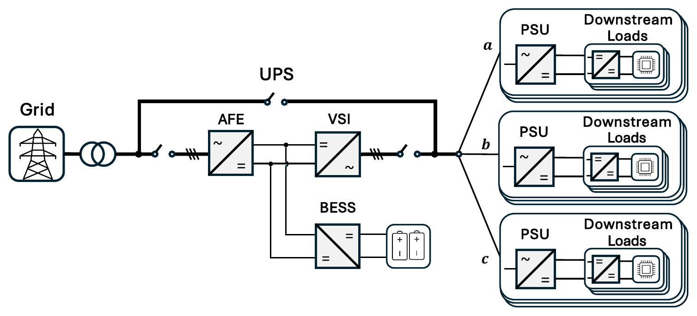
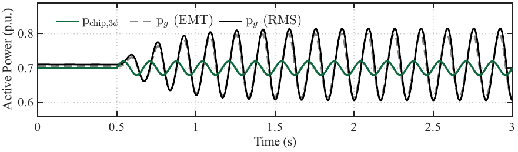

# DC-RMS: Data Center Computing Load RMS odels

DC-RMS provides an open-source MATLAB RMS model of AI data center computing loads supplied by an uninterruptible power supply (UPS). 

The PSCAD/EMTDC cases used to benchmark the RMS model are based on the [Generic EMT Modeling of Data Center Load repository](https://github.com/xingyuz-phd/Generic-EMT-Modeling-of-Data-Center-Load).

This repository accompanies the following paper on RMS model development, validation against EMT simulations, and analysis of how computing load fluctuations propagate to the grid.

> **Dynamic Modeling of Data Center Computing Loads for Power System Studies: From EMT to RMS**  
> Xingyu Zhao, Junbo Zhao, and Yingyi Tang  
> Thayer School of Engineering, Dartmouth College


## Data Center Computing Load Topology

The figure below shows the power path from the grid to the computing chips. In normal operation, a transformer feeds a centralized double-conversion uninterruptible power supply (UPS). Its active front end (AFE) converts grid AC to DC, and its voltage-source inverter (VSI) converts the DC-link voltage back to three-phase AC. A battery energy storage system (BESS) connects to the DC link through a bidirectional DC–DC converter and supplies the inverter during battery backup. In bypass mode, the transformer feeds the load directly through the bypass switch. Across phases $a$, $b$, and $c$, single-phase server power supply units (PSUs) convert AC to DC, and downstream DC–DC converters regulate the voltage supplied to the computing chips.

<p align="center">
  
</p>

## RMS Model Benchmarking Against EMT Simulations

### 1. Voltage Ride-Through and Battery Recovery (`DC_RMS_Normal.m`)

When grid voltage falls to 0.45 p.u. and the sag persists beyond the voltage ride-through (VRT) time limit, the UPS transfers to battery backup. Once grid voltage recovers, the UPS reconnects to the grid and ramps down battery support.

The RMS model closely tracks the EMT results for grid voltage $V_g$, grid active power $p_g$, UPS DC-link voltage $v_{dc}$, and the average power-factor-correction (PFC) capacitor voltage $v_{pfc}^{av}$. The analytical envelope $v_{pfc}^{av} \pm \Delta v_{pfc}$ closely bounds the 120 Hz ($2\omega$) ripple in the EMT voltage waveform of each phase.

<p align="center">
  
</p>

### 2. Propagation of Computing Load Fluctuations (`DC_RMS_Normal.m`)

A 0.5 Hz square wave varies the three-phase computing demand $p_{chip,3\phi}$ between 0.18 and 0.78 p.u., with a 70% duty cycle, to represent recurring GPU workload swings. The RMS model reproduces how the downstream power supply units (PSUs) and the upstream UPS shape the power fluctuations observed at the grid connection.

<p align="center">
  
</p>

### 3. Switching Between Normal and Bypass Modes (`DC_RMS_Bypass.m`)

The UPS starts in normal mode with $p_{chip,3\phi}=0.7$ p.u. At $t=0.5$ s, switching to bypass produces transients in $v_{dc}$ and $p_g$, while $v_{pfc}$ remains essentially unchanged. At $t=1.5$ s, the UPS returns to normal mode. As the voltage-source inverter (VSI) ramps its output current up from zero, all three quantities exhibit transients. The RMS model closely follows the EMT response during both transitions.

<p align="center">
  
</p>

### EMT Validation of Resonant Amplification at 6 Hz (`DC_RMS_Oscillation_Normal.m`)

With the VSI voltage-loop bandwidth set to 25 Hz, a 6 Hz sinusoidal perturbation of amplitude 0.02 p.u. is applied to $p_{chip,3\phi}$. The resulting grid active-power oscillation has **4.64 times the input amplitude in EMT** and **5.23 times the input amplitude in RMS**. The two responses also agree closely in phase. The EMT benchmark confirms the predicted amplification at 6 Hz, with the RMS model giving a somewhat higher gain.

<p align="center">
  
</p>

## Repository Structure

```text
DC-RMS/
├── README.md
├── docs/figures/                           # PNG figures displayed below
├── EMT/                                    # PSCAD/EMTDC benchmark cases
│   ├── DC_EMT_lib.pslx                     # EMT component library
│   ├── DC_EMT_ws.pswx                      # PSCAD workspace
│   ├── DC_EMT_normal.pscx                  # Voltage sag and square-wave load cases
│   ├── DC_EMT_bypass.pscx                  # Normal-to-bypass and return transitions
│   └── DC_EMT_normal_oscillation.pscx      # 6 Hz load perturbation
└── RMS/                                    # MATLAB scripts, EMT reference data, and figures
    ├── DC_RMS_Normal.m                     # Figs. 1 and 2
    ├── DC_RMS_Bypass.m                     # Fig. 3
    ├── DC_RMS_Modal_Normal.m               # Figs. 4 and 5
    ├── DC_RMS_Modal_Bypass.m               # Figs. 6 and 7
    ├── DC_RMS_Oscillation_Normal.m         # Fig. 8
    ├── Normal_EMT_PerUnit_Data.xlsx
    ├── Bypass_EMT_PerUnit_Data.xlsx
    ├── Normal_Oscillation_EMT_PerUnit_Data.xlsx
    └── Fig1_*.pdf ... Fig8_*.pdf            # Vector figures
```

## Citation

If you use the RMS model or the analyses in this repository, please cite the accompanying paper.

```bibtex
@misc{Zhao2026DCRMS,
  author = {Zhao, Xingyu and Zhao, Junbo and Tang, Yingyi},
  title  = {Dynamic Modeling of Data Center Computing Loads for Power System Studies: From {EMT} to {RMS}},
  year   = {2026},
  note   = {Preprint under review}
}
```

If you use the PSCAD/EMTDC benchmark models, please also cite the paper describing the underlying EMT model.

```bibtex
@misc{Zhao2026DCEMT,
  author        = {Zhao, Xingyu and Tang, Yingyi and Zhao, Junbo},
  title         = {Open-Source Multi-Fidelity {EMT} Modeling of Data Center Loads for Power System Studies},
  year          = {2026},
  eprint        = {2611.10179},
  archivePrefix = {arXiv},
  primaryClass  = {eess.SY},
  doi           = {10.48550/arXiv.2611.10179},
  url           = {https://arxiv.org/abs/2611.10179}
}
```
